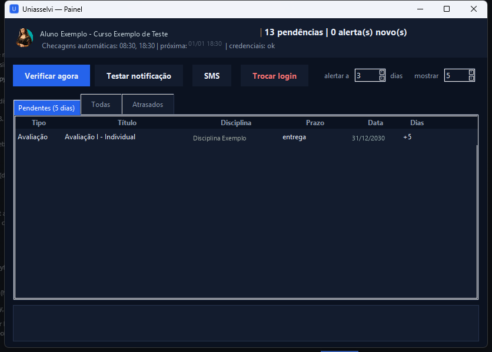
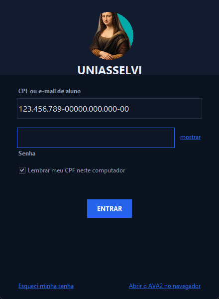
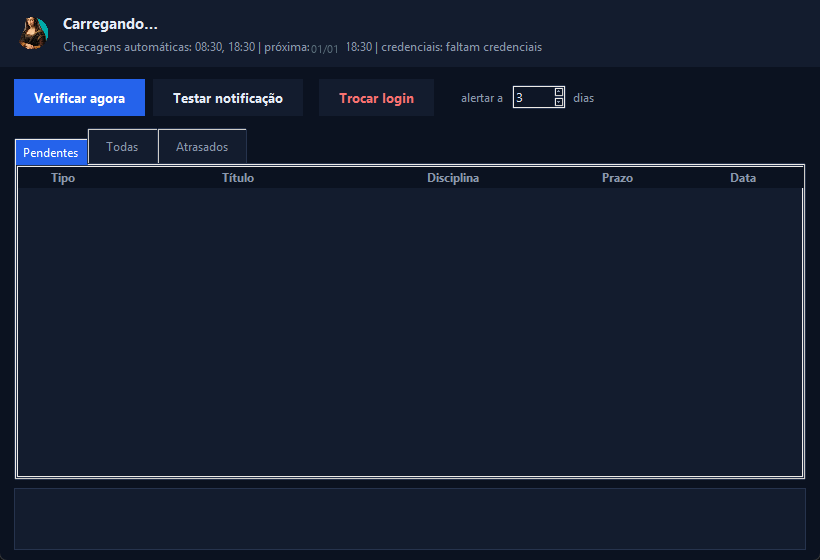

# Uniasselvi AVA2 — Monitor de Provas e Trabalhos


App desktop que acompanha o portal AVA2 da Uniasselvi e dispara **notificações do
Windows** quando falta pouco (limiar configurável, padrão 3 dias) para:

- entregar **trabalhos, produções e atividades complementares**;
- **marcar prova** (janela de agendamento de prova presencial);
- realizar provas já agendadas ou online.

Escrito para uso pessoal. Não é afiliado à Uniasselvi e não usa API oficial —
ver [Aviso](#aviso).

---

## O problema que ele resolve

O AVA2 publica prazos em três janelas diferentes, e o portal só avisa dentro do
prazo. Perder a **janela de agendamento** de uma prova presencial custa mais do
que perder a prova: se a janela fecha, a prova não acontece.

| Situação no portal | Campo que a produz | Alerta gerado |
|---|---|---|
| Prova que precisa ser agendada, ainda não agendada | `need_schedule` sem `has_schedule` | prazo para **marcar** prova, usando `schedule_window_end` |
| Prova já agendada | `has_schedule` + `schedule.data` | confirmação do agendamento, com hora e local |
| Prova online / trabalho | `realization_date` / `end_date` ou janela de realização | prazo de **entrega** |

---

## Screenshots



*Nome do aluno, nome do curso, disciplina e datas na imagem são fictícios: a
captura original foi redigida antes de publicar.*

| Tela de login | Painel carregando |
|---|---|
|  |  |

O campo de CPF da tela de login mostra o placeholder `123.456.789-00` da própria
UI, não um valor real.

---

## Arquitetura

```
launcher.py ──► uniasselvi/watcher.py ──► uniasselvi/api.py ──► portal AVA2
                     │                        │
                     ▼                        ▼
              uniasselvi/models.py     debug/*.json (local, gitignored)
              parsing das 3 janelas
                     │
                     ▼
              uniasselvi/notifier.py ──► toast Win11 → WinRT/PowerShell → popup
                     │
                     ▼
              uniasselvi/sms.py (opcional) ──► Zenvia / Twilio

uniasselvi/gui.py       Tkinter: painel, login, SMS, bandeja
uniasselvi/config.py    config.json + senha via DPAPI
uniasselvi/instance.py  lock de instância única (monitor.pid)
uniasselvi/autostart.py atalho no Startup + tarefa agendada
```

Duas camadas de agendamento, independentes:

1. **Monitor do Startup** (`launcher.py --auto`): ao logar no Windows, checa
   imediatamente e depois nos horários de `check_times`.
2. **Tarefa agendada do Windows**: roda a checagem diária mesmo com o app fechado.
   Com `StartWhenAvailable`, se o PC estava desligado no horário, a checagem roda
   ao ligar.

`state.json` faz a deduplicação: cada pendência notifica **uma única vez**, então
as duas camadas não produzem toast duplicado.

---

## Como rodar

```bash
python -m venv .venv
.venv\Scripts\activate
pip install -r requirements.txt

python launcher.py                 # launcher com tela de login
python app.py login                # grava a senha (DPAPI)
python app.py check                # checagem única + notificações
python app.py watch                # loop no terminal, nos horários do config
python test_offline.py             # suíte offline original do projeto
pytest                             # 91 testes
```

`pywin32` (DPAPI) e `win11toast` são específicos de Windows — o app não roda em
outro SO. Os testes de parsing, agendamento e deduplicação rodam em qualquer um.

---

## Configuração (`config.json`, criado no primeiro uso)

| chave | padrão | efeito |
|---|---|---|
| `cpf` | `""` | CPF ou e-mail de aluno |
| `alert_days` | `3` | dispara toast quando faltam ≤ N dias |
| `view_days` | `5` | aba "Pendentes" mostra até N dias à frente |
| `check_times` | `["08:30","18:30"]` | horários das checagens automáticas |
| `specialization` | `""` | código do curso (vazio = primeiro da lista) |
| `quiet_hours` | `22:00–07:00` | não dispara toast nesse horário |
| `include_complementary` / `include_calendar` | `true` | inclui atividades/produções |
| `sms_enabled` / `sms_to` | `false` / `""` | SMS além do toast |

Nada disso vai para o repositório: `config.json`, `state.json`, `.cred`,
`.cred_sms`, `monitor.pid` e `app.log` estão no `.gitignore`.

---

## Credenciais

A senha do portal é cifrada com **DPAPI** (`CryptProtectData`) e guardada em
`.cred`, ligada ao usuário Windows que a gravou — outro usuário da mesma máquina
não decifra. O token de SMS segue o mesmo caminho em `.cred_sms`.

Nenhum segredo está no código. Os telefones que aparecem em `config.py` e `gui.py`
são placeholders de UI (`+555****9999`).

---

## Executável (PyInstaller)

```bat
build_exe.bat
```

Modo **onedir**: `dist\UniasselviApp\UniasselviApp.exe` + `_internal\` (Python
embutido). Abre rápido e é menos suspeito para antivírus que onefile.

| comando | efeito |
|---|---|
| `UniasselviApp.exe` | launcher/painel |
| `UniasselviApp.exe --auto` | monitor de fundo com ícone na bandeja |
| `UniasselviApp.exe --check` | checagem única (o que a tarefa agendada roda) |
| `UniasselviApp.exe --selftest` | confere imports e notificação, grava `selftest.log` |

Os dados do app vivem ao lado do `.exe`. Defina `PYTHON` antes de rodar o `.bat`
se o seu interpretador não for o `python` do PATH.

---

## Notificação por SMS (opcional)

Além do toast, o app envia SMS quando um prazo entra na janela de alerta.

| provedor | o que precisa |
|---|---|
| **Zenvia** | token da API em `app.zenvia.com` |
| **Twilio** | Account SID + AuthToken + número remetente alugado |

O SMS é enviado mesmo no horário silencioso (o `quiet_hours` vale só para toast).
O texto é truncado a 160 caracteres para caber em um segmento.

---

## Bandeja do sistema

- Clicar no **X** do painel minimiza para a bandeja (ícone perto do relógio) — o
  monitor continua rodando. Clique no ícone para reabrir; o menu tem Abrir painel ·
  Verificar agora · Abrir AVA2 · Sair.
- O modo `--auto` do Startup também mostra o ícone, para você saber que está
  monitorando.
- Notificação em três camadas: toast nativo do Windows 11 via `win11toast`; se
  falhar, toast WinRT via PowerShell; se falhar, popup tkinter que se fecha sozinho.

---

## Fragilidades conhecidas (declaradas, não escondidas)

**Fallback de senha em texto puro.** Se `pywin32` não importa, `save_password()`
grava a senha em `.cred.plain` como JSON legível, e o token de SMS vai em claro
para `.cred_sms`. O caminho DPAPI é o normal, mas a alternativa existe. Um app que
depende de DPAPI deveria falhar em vez de degradar para texto puro.

**Endpoints descobertos por engenharia reversa.** As rotas vieram do bundle JS do
AVA2, não de API publicada. Se a Uniasselvi mudar o formato, o parser quebra — por
isso as respostas brutas são gravadas em `debug/*.json`.

**Acoplamento a portal de terceiros.** Ver [Aviso](#aviso).

**`_pid_alive()` aceita qualquer processo cujo nome comece com `python`.** Se
outro script Python gravou um PID, o app pode acreditar que o monitor dele é o seu
e não subir um segundo.

**Truncar SMS a 160 caracteres corta conteúdo sem avisar.** Evita custo de
multi-segmento, mas a mensagem pode chegar incompleta.

**Sem retry nas chamadas HTTP.** Falha de rede numa checagem derruba a rodada
inteira; a próxima janela recupera, mas o alerta pode atrasar horas.

**Classificação por substring na descrição.** `prova`/`trabalho`/`avaliação` saem
de palavras em `type_description`. É frágil por natureza; o sinal estrutural
(`need_schedule`) tem prioridade, mas descrições novas podem cair na categoria
errada.

### Bugs encontrados ao escrever os testes (corrigidos neste repo)

- **`_kind_for_test()` classificava trabalho como prova.** O teste de `"final" in
  desc` vinha antes dos marcadores de trabalho, então "Síntese final", "Produção
  final" e "Trabalho final" viravam **prova** — e o alerta dizia "marque a prova"
  para um trabalho. Ordem corrigida: `need_schedule` primeiro, marcadores de
  trabalho depois, `"final"` por último.
- **`_send_zenvia()` não removia parênteses.** Removia `+`, espaço e hífen, então
  `+55 (51) 99999-9999` chegava como `55(51)999999999` e a Zenvia recusava. Agora
  normaliza por dígitos.
- **`next_run_times()` tinha o `datetime.replace()` fora do `try`.** Um
  `check_times` com hora inválida (`"25:00"`) passava por `_parse_hm` e derrubava
  `replace()` com `ValueError` não capturado, quebrando o loop de agendamento
  inteiro.

---

## Aviso

Este projeto automatiza acesso a um portal de terceiros. Ele reproduz chamadas que
o próprio site faz no navegador, com `Origin`/`Referer` ajustados para que o WAF
trate a requisição como a do site. Isso não é uso de API oficial nem está coberto
por contrato. Antes de usar:

- leia os termos de uso do portal;
- automatizar o próprio login pode violar esses termos;
- se você não é o aluno dono das credenciais, não use.

O código está aqui como material de portfólio de engenharia desktop em Python
(Tkinter, DPAPI, PyInstaller, integração com notificações do Windows), não como
recomendação de uso.

---

## Testes

```bash
pytest
```

91 testes sobre o código que existe: parsing das três janelas de prazo,
classificação prova/trabalho, regra de "marcar prova", deduplicação entre as duas
camadas de agendamento, janela silenciosa cruzando a meia-noite, cálculo do
próximo horário, citação de aspas no PowerShell, normalização de telefone,
round-trip de DPAPI e o lock de instância única.

`test_offline.py` é a suíte original do projeto (17 checagens), mantida como está.

---

## Licença

Todos os direitos reservados — ver [LICENSE](LICENSE). Publicado como
demonstração de portfólio; não é software de código aberto nem licença para uso em
produção.
